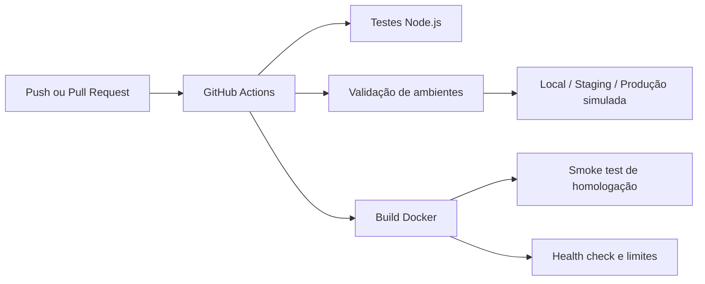

# Cloud DevOps Lab

**Portfólio de DevOps e Engenharia de Plataformas** · Node.js 22 · Docker · Docker Compose · GitHub Actions · CI/CD

> **Em 60 segundos:** laboratório de containers com segurança por padrão, testes automatizados, limites de recursos e validação de três perfis de ambiente. O objetivo é demonstrar engenharia reproduzível, não anunciar infraestrutura em nuvem já implantada.

[](https://github.com/juniordev830/devops-control-center/actions/workflows/ci.yml)

**Para avaliação rápida:** [Código do laboratório](labs/hello-service/) · [Pipeline CI](.github/workflows/ci.yml) · [Perfis de ambiente](docs/environment-profiles.md) · [Execuções dos testes](https://github.com/juniordev830/devops-control-center/actions) · [Pull request de desenvolvimento](https://github.com/juniordev830/devops-control-center/pull/3)

### Arquitetura em uma imagem



**Estado do projeto:** CI e homologação simulada implementados; painel gráfico, Terraform e aprovação manual de produção ainda em desenvolvimento. Nenhuma nuvem paga foi provisionada.

Laboratório prático de engenharia de plataformas: ambientes reproduzíveis, containers e automação de validação. **Não é um monitor de GitHub Actions**: o Codax concentra o monitoramento de repositórios.

## Visão para recrutadores

Este repositório demonstra competências práticas em **DevOps, engenharia de plataformas e automação de infraestrutura**. Cada funcionalidade tem evidências verificáveis no código e no GitHub Actions; o projeto não afirma possuir implantação em nuvem quando ela ainda não existe.

| Competência | Evidência verificável |
| --- | --- |
| Containers e Docker Compose | `labs/hello-service/Dockerfile` e `labs/hello-service/compose.yaml` |
| Segurança básica de containers | Usuário não-root, filesystem somente leitura, capacidades removidas e `no-new-privileges` |
| Controle de recursos | Limites de 128 MiB, 0,5 CPU e 100 PIDs, conferidos no CI |
| Integração contínua | `.github/workflows/ci.yml`: testes Node, build, execução e health checks |
| Observabilidade inicial | Endpoint HTTP `GET /health`, validado automaticamente |

**Para avaliar pelo navegador:** consulte o [teste de isolamento](scripts/verify-environments.mjs), os [testes do serviço](tests/lab.test.js) e os logs da aba **Actions**. A verificação sobe três containers simultaneamente, confere suas configurações reais e comprova que desligar homologação preserva os outros ambientes. Painel de infraestrutura e Terraform continuam pendentes.

## Objetivos
- Construir ambientes de desenvolvimento locais isolados com Docker Compose.
- Validar infraestrutura e aplicações com pipelines CI.
- Demonstrar boas práticas de health checks, configuração e documentação.

## Primeiro laboratório: serviço de demonstração

Execução sem Docker: `npm start` (porta 8080). Testes locais: `npm test`. O comando padrão agora executa o laboratório novo, não a antiga API de pipelines.

```bash
docker compose -f labs/hello-service/compose.yaml up --build
curl http://127.0.0.1:8080/health
docker compose -f labs/hello-service/compose.yaml down
```

Requisitos: Docker Engine e Compose v2. A porta publicada fica vinculada a 127.0.0.1; nenhuma chave é necessária.

## Estrutura de migração

O projeto original tinha uma API de pipelines com dados demonstrativos. Esta branch inicia sua substituição por um laboratório de infraestrutura. A API legada de pipelines e seus testes foram removidos nesta branch. O histórico Git permanece disponível. Não há implantação em nuvem ativa nem custos provisionados.


## Pipeline e validação contínua

A integração contínua executa testes Node e `node scripts/verify-environments.mjs`: constrói e inicia os três perfis simultaneamente, verifica saúde, identidade, redes, portas, hardening e limites reais do Docker; desliga homologação, confirma a saúde dos outros perfis e remove os recursos do teste. Consulte [GitHub Actions](https://github.com/juniordev830/devops-control-center/actions) para evidências de execução. Cada execução ocorre nos runners do GitHub e não exige manter este chat aberto.

**Segurança operacional:** homologação é uma simulação local no runner, não uma implantação pública. O perfil de produção também é uma simulação; nenhuma implantação real é acionada automaticamente. Aprovação de produção e provisionamento em nuvem dependem de configuração e autorização separadas.

## Próximas entregas

Simulação manual de produção, painel de infraestrutura e templates de infraestrutura como código. Toda implantação remota exigirá credenciais e autorização específicas.
